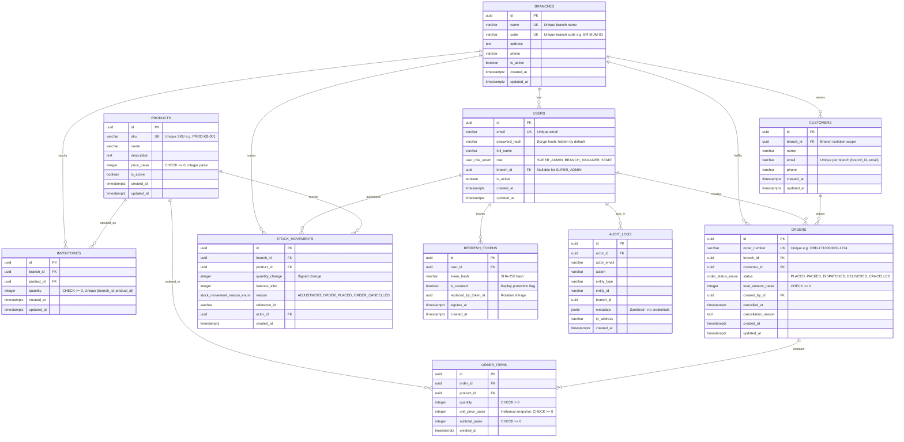

# Aarnex Tech Entity-Relationship (ER) Diagram

The following diagram illustrates the relational database model implemented in PostgreSQL via TypeORM entities, including primary keys, foreign keys, cardinality, uniqueness constraints, and checks.

### Key Architectural Constraints
1. **Branch Scoping & Isolation**:
   - `customers` table maintains a compound unique index on `(branch_id, email)`.
   - `inventories` table enforces uniqueness on `(branch_id, product_id)`.
2. **PostgreSQL Integrity Checks**:
   - Monetary values stored strictly as integer paise (`price_paise`, `total_amount_paise`, `unit_price_paise`, `subtotal_paise`) with check constraint `>= 0`.
   - Inventory quantity protected at the database engine level with check constraint `quantity >= 0`.
3. **Pessimistic Concurrency**:
   - Inventory reservation uses `SELECT ... FOR UPDATE` with deterministic lock ordering (sorted `product_id`s) to prevent overselling and eliminate deadlocks.
